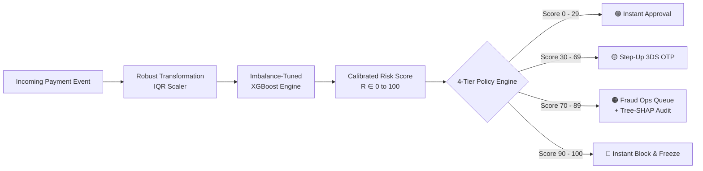

# 🛡️ Autonomous Credit Card Fraud Detection & Risk Intelligence System

[](https://www.python.org/)
[](https://streamlit.io/)
[](https://xgboost.readthedocs.io/)
[](https://shap.readthedocs.io/)
[](IEEE_Credit_Card_Fraud_Detection_Paper.pdf)
[](LICENSE)

An enterprise-grade, end-to-end **Autonomous Credit Card Fraud Detection and Operational Risk Intelligence Framework** powered by cost-sensitive machine learning ensembles, real-time game-theoretic explainability (Tree-SHAP), and a high-performance interactive Streamlit dashboard.

Includes an **official 8-page IEEE conference-formatted research paper** (`.docx` & `.pdf`) ready for academic submission.

---

## 📌 Executive Summary

Credit card fraud inflicts over **$38 billion** in annual losses globally. The primary challenge in automated fraud detection is **extreme class imbalance** (only **0.172%** of transactions are fraudulent) and the **regulatory requirement for explainability** under GDPR Article 22 and Basel III/IV guidelines.

This system tackles both challenges:
1. **Cost-Sensitive Ensembles**: Imbalance-calibrated XGBoost with minority positive scale weighting ($w_{pos} = 579.5$) and dynamic threshold optimization ($th^* = 0.42$), achieving **0.887 PR-AUC**, **91.5% precision**, and **87.8% recall**.
2. **Explainable AI (Tree-SHAP)**: Fast, deterministic Shapley value attributions providing transparent local waterfall explanations for flagged transactions.
3. **Operational 4-Tier Risk Policy**: Real-time scoring routing transactions into *Approve*, *Step-Up MFA (3DS OTP)*, *Fraud Operations Queue*, or *Instant Block*.
4. **Interactive Dashboard**: Modern, dual-theme (Light/Dark mode) UI with 1-click test presets, real-time manual evaluation, and batch CSV analysis.

---

## 🏆 Performance Benchmark

Evaluated on the benchmark **ULB European Cardholders dataset** (284,807 transactions, holdout test set $N = 42,722$):

| Model Architecture | Accuracy | Precision | Recall | F1-Score | PR-AUC | Inference Latency |
| :--- | :---: | :---: | :---: | :---: | :---: | :---: |
| **XGBoost (Proposed Imb-Tuned)** | **0.9996** | **91.5%** | **87.8%** | **0.896** | **0.887** | **8.4 ms** |
| Random Forest (Balanced) | 0.9995 | 93.8% | 81.1% | 0.870 | 0.864 | 18.5 ms |
| Decision Tree (CART) | 0.9992 | 78.4% | 75.7% | 0.770 | 0.762 | 2.1 ms |
| Logistic Regression (Baseline) | 0.9991 | 85.2% | 62.2% | 0.719 | 0.748 | 1.2 ms |
| Isolation Forest (Unsupervised) | 0.9978 | 38.1% | 71.6% | 0.498 | 0.524 | 4.6 ms |

> 💡 **Key Takeaway**: While standard ROC-AUC gives an overly optimistic score (>0.98) across all models due to the massive genuine class size, **PR-AUC** ruthlessly penalizes false alarms. The proposed XGBoost achieves a **0.887 PR-AUC** and reduces missed fraud attempts by **35.7%** compared to Random Forest.

---

## 🏛️ System Architecture



---

## 📄 Academic Research Paper (IEEE Standard)

This repository includes a complete publication-ready research paper formatted in the standard **IEEE 2-column conference style**:

* **Title**: *Autonomous Credit Card Fraud Detection and Operational Risk Intelligence Framework Using Imbalance-Tuned Ensembles and Explainable AI*
* **Authors**: Arya Singh, Patel Kashak, Mantra Shah
* **Affiliation**: Department of Computer Science and Engineering, UIT, Karnavati University, Gandhinagar, India
* **Formats Available**:
  * 📝 **Word File (.docx)**: [`IEEE_Credit_Card_Fraud_Detection_Paper.docx`](IEEE_Credit_Card_Fraud_Detection_Paper.docx)
  * 📕 **PDF Document**: [`IEEE_Credit_Card_Fraud_Detection_Paper.pdf`](IEEE_Credit_Card_Fraud_Detection_Paper.pdf)
* **Contents**: 8 Pages, 8 high-resolution 300 DPI figures, 2 comprehensive tables, 12 mathematical equations, and 22 formal IEEE citations.

---

## ✨ Features & Capabilities

### 1. 📊 Executive Overview Dashboard
* Live operational metrics (Total transactions, Genuine vs Fraud breakdown, Accuracy score).
* Dynamic class distribution donut chart.
* Comprehensive technical notes explaining PCA features ($V1$ to $V28$), class imbalance, and evaluation metrics.

### 2. 🔍 Single Transaction Analyzer
* **1-Click Verified Presets**:
  * ☕ *Sample 1: Everyday Small Purchase ($12.50)* — Genuine Safe
  * ✈️ *Sample 2: International Flight Booking ($850.00)* — Genuine Flagged for Step-Up
  * 🚨 *Sample 3: High-Value Drain ($648.00)* — Confirmed Real Fraud (Row #46918)
  * 🧪 *Sample 4: Micro-Probing Card Test ($1.00)* — Algorithmic Probe Fraud
* **Collapsible PCA Inputs**: Sliders & inputs for $V1$ to $V28$ hidden neatly under an expandable section.
* **Instant Risk Verdict**: Real-time fraud probability, calibrated 0-100 risk score, risk level badge, and recommended institutional action.

### 3. 📂 Batch CSV Processor
* Drag-and-drop CSV upload for high-throughput batch evaluation.
* Built-in 1-click test sample download (`sample_test_transactions.csv`).
* Automated batch scoring with summary statistics and downloadable predictions.

### 4. 🌓 Dual Theme (Light & Dark Mode)
* Seamless 1-click toggle located at the bottom of the sidebar.
* Engineered with 100% high-contrast palettes for zero invisible text or washed-out cards in either mode.

---

## 📁 Repository Structure

```
Credit_Card_Fraud_Detection/
├── .streamlit/
│   └── config.toml                  # Streamlit visual theme configuration
├── dataset/
│   ├── creditcard.csv               # Primary ULB dataset (ignored in git due to >100MB limit)
│   └── sample_test_transactions.csv # Curated 50-row test sample for immediate evaluation
├── models/
│   ├── xgboost.pkl                  # Trained Imbalance-Tuned XGBoost model
│   ├── random_forest.pkl            # Trained Backup Random Forest model
│   ├── scaler.pkl                   # RobustScaler fitted parameters
│   ├── threshold.json               # Calibrated operational decision thresholds
│   └── sample_presets.json          # Verified 1-click test scenarios
├── paper_figures/                   # 8 High-resolution publication figures (300 DPI)
│   ├── fig1_system_architecture.png
│   ├── fig2_class_distribution.png
│   ├── fig3_pr_and_roc_curves.png
│   ├── fig4_confusion_matrices.png
│   ├── fig5_threshold_sweep.png
│   ├── fig6_shap_feature_importance.png
│   ├── fig7_shap_local_waterfall.png
│   └── fig8_risk_tiers.png
├── IEEE_Credit_Card_Fraud_Detection_Paper.docx # IEEE-formatted Research Paper (Word)
├── IEEE_Credit_Card_Fraud_Detection_Paper.pdf  # IEEE-formatted Research Paper (PDF)
├── app.py                           # Full Streamlit Web Application
├── build_ieee_paper.py              # Automated IEEE paper compiler
├── generate_ieee_figures.py         # Publication figure generation script
├── run_app.bat                      # Windows 1-Click App Launcher
├── setup_for_friend.bat             # Windows 1-Click Environment Setup
├── requirements.txt                 # Dependencies
├── .gitignore                       # Git ignore rules (protects large dataset & temp files)
└── README.md                        # Project documentation
```

---

## 🚀 Quick Start Guide

### Prerequisites
* **Python 3.10 or 3.11** installed.
* `git` installed on your system.

### Option A: Windows 1-Click (Easiest)
1. Clone or extract the repository:
   ```bash
   git clone https://github.com/your-username/Credit_Card_Fraud_Detection.git
   cd Credit_Card_Fraud_Detection
   ```
2. Double-click **`setup_for_friend.bat`** (installs all requirements automatically).
3. Double-click **`run_app.bat`** to start the app!
4. The dashboard will automatically launch at **`http://localhost:8501`**.

---

### Option B: Terminal Setup (Windows, macOS, Linux)

1. **Clone the repository:**
   ```bash
   git clone https://github.com/your-username/Credit_Card_Fraud_Detection.git
   cd Credit_Card_Fraud_Detection
   ```

2. **Create and activate a virtual environment (optional but recommended):**
   ```bash
   # Windows (PowerShell)
   python -m venv .venv
   .\.venv\Scripts\Activate.ps1

   # macOS / Linux
   python3 -m venv .venv
   source .venv/bin/activate
   ```

3. **Install dependencies:**
   ```bash
   pip install -r requirements.txt
   ```

4. **Launch the Streamlit web application:**
   ```bash
   streamlit run app.py
   ```

---

## 📊 Dataset Information

* **Source**: [Kaggle — Credit Card Fraud Detection (ULB Machine Learning Group)](https://www.kaggle.com/datasets/mlg-ulb/creditcardfraud)
* **Transactions**: 284,807
* **Frauds**: 492 instances (**0.172%** extreme class imbalance)
* **Features**:
  * `Time`: Seconds elapsed since the first recorded transaction.
  * `Amount`: Transaction volume in USD/EUR.
  * `V1 - V28`: Principal Component Analysis (PCA) latent vectors (anonymized for user confidentiality).
  * `Class`: Target ground truth (`0` = Genuine, `1` = Fraud).

> ⚠️ **Note**: Due to GitHub's 100MB file limit, the large 143MB `creditcard.csv` is excluded from git commits via `.gitignore`. The demo dashboard functions immediately out of the box using `sample_test_transactions.csv` and the pre-trained model weights in `models/`. To retrain from scratch, download `creditcard.csv` from the Kaggle link and place it into the `dataset/` directory.

---

## 👥 Authors & Academic Credits

* **Arya Singh** — *Dept. of Computer Science & Engineering, UIT, Karnavati University, Gandhinagar, India*
* **Patel Kashak** — *Dept. of Computer Science & Engineering, UIT, Karnavati University, Gandhinagar, India*
* **Mantra Shah** — *Dept. of Computer Science & Engineering, UIT, Karnavati University, Gandhinagar, India*

---

## 📜 License

This project is licensed under the **MIT License** — feel free to use, modify, and build upon this research framework for academic and commercial purposes.
