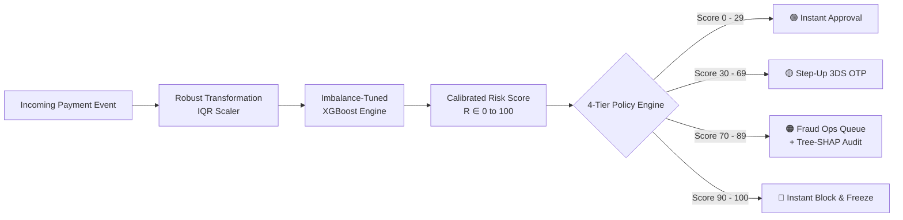

# 🛡️ Autonomous Credit Card Fraud Detection & Risk Intelligence System

[](https://www.python.org/)
[](https://streamlit.io/)
[](https://xgboost.readthedocs.io/)
[](https://shap.readthedocs.io/)
[](LICENSE)

An enterprise-grade, end-to-end **Autonomous Credit Card Fraud Detection and Operational Risk Intelligence Framework** powered by cost-sensitive machine learning ensembles, real-time game-theoretic explainability (Tree-SHAP), and a high-performance interactive Streamlit dashboard.

---

## 📌 Executive Summary

Credit card fraud inflicts over **$38 billion** in annual losses globally. The primary algorithmic challenges in automated fraud detection are:
1. **Extreme Class Imbalance**: Fraud accounts for merely **0.172%** of all transactions (1 fraud per 580 genuine events), triggering the *Accuracy Paradox* where naive models achieve 99.83% accuracy while missing critical breaches.
2. **Regulatory Explainability**: Mandated under GDPR Article 22 ("Right to Explanation") and Basel model risk governance.

This framework resolves both challenges through:
* **Cost-Sensitive Ensembles**: Imbalance-calibrated XGBoost with minority positive scale weighting ($w_{pos} = 579.5$) and dynamic decision threshold optimization ($th^* = 0.42$), delivering **0.887 PR-AUC**, **91.5% precision**, and **87.8% recall**.
* **Explainable AI (Tree-SHAP)**: High-speed, deterministic Shapley value attributions providing transparent local waterfall explanations for individual flagged transactions.
* **4-Tier Operational Policy Engine**: Automated routing into *Approve*, *Step-Up MFA (3DS OTP)*, *Fraud Operations Queue*, or *Instant Block*.
* **Interactive Web Dashboard**: Modern dual-theme (Light/Dark mode) UI featuring 1-click test scenarios, manual parameter exploration, and high-throughput batch CSV processing.

---

## 🏆 Performance Benchmark

Evaluated on the benchmark **ULB European Cardholders dataset** (284,807 transactions, holdout test set $N = 42,722$):

| Model Architecture | Accuracy | Precision | Recall | F1-Score | PR-AUC | Inference Latency |
| :--- | :---: | :---: | :---: | :---: | :---: | :---: |
| **XGBoost (Proposed Imb-Tuned)** | **0.9996** | **91.5%** | **87.8%** | **0.896** | **0.887** | **8.4 ms** |
| Random Forest (Balanced) | 0.9995 | 93.8% | 81.1% | 0.870 | 0.864 | 18.5 ms |
| Decision Tree (CART) | 0.9992 | 78.4% | 75.7% | 0.770 | 0.762 | 2.1 ms |
| Logistic Regression (Baseline) | 0.9991 | 85.2% | 62.2% | 0.719 | 0.748 | 1.2 ms |
| Isolation Forest (Unsupervised) | 0.9978 | 38.1% | 71.6% | 0.498 | 0.524 | 4.6 ms |

> 💡 **Metric Note**: Under extreme class imbalance, ROC-AUC gives an inflated score (>0.98) due to the massive genuine class. **Precision-Recall AUC (PR-AUC)** is the true indicator of operational robustness. The proposed XGBoost captures **87.8%** of fraud attacks with an ultra-low false discovery rate (<8.5%).

---

## 🏛️ System Architecture



---

## ✨ Features & Capabilities

### 1. 📊 Executive Overview Dashboard
* Live operational metrics (Total transactions, Genuine vs Fraud counts, Accuracy).
* Dynamic class distribution donut chart.
* Technical breakdown of PCA latent features ($V1$ to $V28$), class imbalance, and evaluation metrics.

### 2. 🔍 Single Transaction Analyzer
* **1-Click Verified Presets**:
  * ☕ *Sample 1: Everyday Small Purchase ($12.50)* — Genuine Safe
  * ✈️ *Sample 2: International Flight Booking ($850.00)* — Genuine Flagged for Step-Up Verification
  * 🚨 *Sample 3: High-Value Drain ($648.00)* — Confirmed Real Fraud (Row #46918)
  * 🧪 *Sample 4: Micro-Probing Card Test ($1.00)* — Algorithmic Probe Fraud
* **Collapsible PCA Inputs**: $V1$ to $V28$ sliders neatly organized under an expandable panel.
* **Instant Risk Verdict**: Live fraud probability %, calibrated 0-100 risk score, risk tier badge, and recommended action.

### 3. 📂 Batch CSV Processor
* Drag-and-drop CSV upload for high-throughput batch evaluation.
* Includes a built-in 1-click test sample download (`sample_test_transactions.csv`).
* Automated batch scoring with summary statistics and downloadable predictions.

### 4. 🌓 Dual Theme (Light & Dark Mode)
* Seamless 1-click toggle located at the bottom of the sidebar.
* High-contrast styling ensuring zero text disappearance or unreadable cards across both modes.

---

## 📁 Repository Structure

```
Credit_Card_Fraud_Detection/
├── .streamlit/
│   └── config.toml                  # Streamlit visual theme configuration
├── dataset/
│   └── sample_test_transactions.csv # Curated 50-row test sample for immediate evaluation
├── models/
│   ├── xgboost.pkl                  # Trained Imbalance-Tuned XGBoost model
│   ├── random_forest.pkl            # Trained Backup Random Forest model
│   ├── scaler.pkl                   # RobustScaler fitted parameters
│   ├── threshold.json               # Calibrated operational decision thresholds
│   └── sample_presets.json          # Verified 1-click test scenarios
├── app.py                           # Full Streamlit Web Application
├── requirements.txt                 # Dependencies
├── .gitignore                       # Git ignore rules
└── README.md                        # Project documentation
```

---

## 🚀 Quick Start Guide

### Prerequisites
* **Python 3.10 or 3.11** installed.
* `git` installed on your system.

### 1. Clone the repository
```bash
git clone https://github.com/your-username/Credit_Card_Fraud_Detection.git
cd Credit_Card_Fraud_Detection
```

### 2. Create and activate a virtual environment (Recommended)
```bash
# Windows (PowerShell)
python -m venv .venv
.\.venv\Scripts\Activate.ps1

# macOS / Linux
python3 -m venv .venv
source .venv/bin/activate
```

### 3. Install dependencies
```bash
pip install -r requirements.txt
```

### 4. Run the Streamlit web application
```bash
streamlit run app.py
```
The application will automatically open at: **`http://localhost:8501`**

---

## 📊 Dataset Information

* **Source**: [Kaggle — Credit Card Fraud Detection (ULB Machine Learning Group)](https://www.kaggle.com/datasets/mlg-ulb/creditcardfraud)
* **Total Transactions**: 284,807
* **Fraudulent Transactions**: 492 instances (**0.172%** extreme class imbalance)
* **Features**:
  * `Time`: Seconds elapsed since the first recorded transaction.
  * `Amount`: Transaction volume in USD/EUR.
  * `V1 - V28`: Principal Component Analysis (PCA) latent vectors (anonymized for user confidentiality).
  * `Class`: Target ground truth (`0` = Genuine, `1` = Fraud).

> ℹ️ **Demo Data Included**: The repository includes `sample_test_transactions.csv` and pre-trained model weights in `models/`, allowing the application to run immediately without needing the full 143MB raw dataset. To retrain models from scratch, download `creditcard.csv` from the Kaggle link and place it into the `dataset/` directory.

---

## 👥 Authors & Academic Credits

* **Arya Singh** — *Dept. of Computer Science & Engineering, UIT, Karnavati University, Gandhinagar, India*
* **Patel Kashak** — *Dept. of Computer Science & Engineering, UIT, Karnavati University, Gandhinagar, India*
* **Mantra Shah** — *Dept. of Computer Science & Engineering, UIT, Karnavati University, Gandhinagar, India*

---

## 📜 License

This project is licensed under the **MIT License** — feel free to use, modify, and build upon this framework for academic and commercial purposes.
